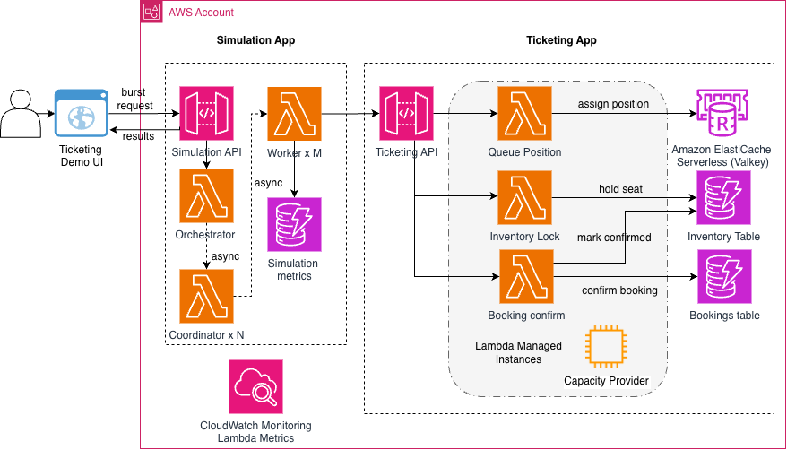

# Concert Ticketing on AWS Lambda Managed Instances

> This is sample code, for non-production usage. You should work with your security and legal teams to meet your organizational security, regulatory and compliance requirements before deployment.

Reference implementation showing how AWS Lambda Managed Instances (LMI) handles predictable traffic bursts — the on-sale surge pattern common to concert tickets, product launches, and other scheduled events. Validated at **40,000 TPS × 120 s** with **p99 121 ms** and zero Lambda-side errors.

## What is This Project?

A spike-tolerant ticketing system that stays warm through the on-sale moment and scales back down when the burst is over:

- **Three-phase booking flow** — `queue-position` → `inventory-lock` → `booking-confirm`, the standard queue-plus-hold-and-confirm pattern for inventory-constrained e-commerce
- **Sharded DynamoDB + Redis** — 500-way sharded inventory table for parallel writes, Redis Serverless for the atomic queue counter
- **Bundled load generator** — three-tier Lambda fan-out (orchestrator → coordinator → worker) that reproduces the on-sale burst shape at any target TPS
- **Optional web UI** — single-page Alpine.js panel for firing bursts and viewing per-burst results without curl gymnastics
- **Pre-warm operational pattern** — `MinExecutionEnvironments` / `MaxExecutionEnvironments` scaling knobs and a script for the "warm up before, scale down after" workflow

### Key Features

- **Validated at 40,000 TPS × 120 s** — p99 121 ms end-to-end, zero Lambda-side errors, zero throttles
- **Per-EE scale-up in 1–2 seconds** — no cold starts; capacity is warm before on-sale opens
- **EC2 pricing model** — Savings Plans and Reserved Instances apply; ~$24 K/yr with a cost-optimized `MinEE` baseline + pre-warm
- **Same Lambda programming model** — no Dockerfile, no ECS task definitions
- **Multi-concurrent handlers** — one execution environment serves 8 simultaneous requests when handlers are thread-safe
- **Reproducible burst tests** — smoke, ramp, and on-sale scenarios out of the box

## Architecture



Three LMI-backed Lambda handlers behind API Gateway. Redis Serverless holds the atomic queue counter; DynamoDB holds durable per-seat state across a write-sharded inventory table and a bookings table. A separate simulation stack fans out load into the ticketing API to reproduce the on-sale burst.

Deep dives:
- [`docs/architecture.md`](docs/architecture.md) — Component details, LMI concepts, load-generator math, concurrency safety
- [`docs/booking-flow.md`](docs/booking-flow.md) — Request sequence diagram and error paths

## Prerequisites

- **AWS CLI v2** configured with sufficient IAM permissions
- **AWS SAM CLI** (`pip install aws-sam-cli`)
- **Python 3.13+** with `boto3` installed (`pip install boto3`) — matches the Lambda runtime and is used by the deploy/scale/cleanup scripts
- **An existing Amazon VPC** with:
  - At least 2 subnets in different AZs (3 recommended)
  - NAT Gateway or VPC endpoints for DynamoDB and CloudWatch Logs — LMI needs outbound HTTPS to send telemetry
- **AWS Service Quota headroom** — the shipped defaults request ~1,200 vCPU of EC2 capacity, well above default account quotas. See [`Service-Quotas`](docs/deployment-topology.md#service-quotas) for the exact quotas to request. `scripts/deploy.sh` also prints the requirements in its post-deploy summary.

### Required IAM Permissions

Your deployment role needs these in addition to standard SAM permissions:

```json
{
  "Effect": "Allow",
  "Action": [
    "lambda:CreateCapacityProvider",
    "lambda:DeleteCapacityProvider",
    "lambda:GetCapacityProvider",
    "lambda:ListCapacityProviders",
    "lambda:UpdateCapacityProvider",
    "lambda:PutFunctionScalingConfig",
    "iam:PassRole",
    "iam:CreateServiceLinkedRole"
  ],
  "Resource": "*"
}
```

> **Note:** `iam:CreateServiceLinkedRole` is only needed on first use of LMI in the account, or if the service-linked role was deleted.

## Project Structure

```
.
├── ticketing-app/                     # System under test
│   ├── template.yaml                  # AWS SAM / CloudFormation
│   ├── samconfig.toml
│   └── src/
│       ├── queue_position/handler.py  # Virtual queue assignment (Redis INCR)
│       ├── inventory_lock/handler.py  # Seat hold with optimistic locking (DDB)
│       └── booking_confirm/handler.py # Atomic booking confirmation (DDB TransactWrite)
│
├── simulation-app/                    # Load generator
│   ├── template.yaml
│   ├── samconfig.toml
│   └── src/
│       ├── orchestrator/handler.py    # Ramp→sustain loop; fans out to coordinators
│       ├── coordinator/handler.py     # Middle tier; spawns N workers in parallel
│       ├── load_worker/handler.py     # HTTP burst worker (~1,000 req/s while running)
│       └── dashboard/handler.py       # Metrics aggregator + ground-truth queries
│
├── demo-ui/                           # Optional local UI for firing bursts
│   ├── index.html                     # Single-page Alpine.js panel
│   ├── app.js
│   ├── config.js                      # Set SIMULATION_API_URL here
│   ├── styles.css
│   └── serve.py                       # Local dev server (no-cache headers)
│
├── scripts/
│   ├── deploy.sh                      # Deploy both stacks in sequence
│   ├── scale-for-onsale.sh            # Manual pre-warm / scale-down trigger
│   └── cleanup.sh                     # Delete both stacks + retained tables
│
├── docs/                              # Architecture, booking flow, deployment topology,
│                                      # test results, cost analysis
└── README.md
```

## Deployment

### Option 1: Automated (recommended)

```bash
./scripts/deploy.sh vpc-0abc1234 "subnet-0aaa1111,subnet-0bbb2222,subnet-0ccc3333"
```

This script:
1. Updates `samconfig.toml` in both apps with your VPC ID, subnet IDs, and region
2. Builds and deploys the **Ticketing App** (capacity provider, LMI functions, DynamoDB tables)
3. Publishes Lambda function versions and applies the per-function `MinExecutionEnvironments` / `MaxExecutionEnvironments` scaling config via `put-function-scaling-config` (SAM's `AWS::Serverless::Function` silently ignores the nested property, so the script applies it explicitly)
4. Builds and deploys the **Simulation App**, wiring in the live Ticketing API endpoint
5. Prints both API endpoints, the required Service Quota values, and a ready-to-run curl command

### Option 2: Manual

After `deploy.sh` has run once, both `samconfig.toml` files are populated. Redeploy either app directly:

```bash
cd ticketing-app && sam deploy
cd simulation-app && sam deploy
```

For a fresh manual deploy (without `deploy.sh`), edit the `parameter_overrides` in each `samconfig.toml` to replace the `REPLACE_WITH_*` placeholders with your VPC ID, subnet IDs, and Ticketing API endpoint.

### Optional: enable the AWS Budgets alarm

The ticketing stack ships an optional `AWS::Budgets::Budget` resource that fires email alerts at 80% and 100% of a configured monthly spend ceiling. It is created only when `BudgetNotificationEmail` is set at deploy time. To enable it via `deploy.sh`, export the email address before running:

```bash
BUDGET_EMAIL=ops@example.com \
./scripts/deploy.sh vpc-0abc1234 "subnet-0aaa1111,subnet-0bbb2222"
```

The default threshold is set by the `BudgetMonthlyUsd` template parameter; override it in `ticketing-app/samconfig.toml` or on the SAM CLI if you want a different ceiling. If `BUDGET_EMAIL` is unset the deploy proceeds without the alarm.

## Local Handler Testing

For a quick sanity check without deploying, each handler can be invoked locally with the SAM CLI. This runs the function in a Docker container with the environment variables from `template.yaml` and your current AWS credentials, so AWS SDK calls go to real DynamoDB and ElastiCache. It is useful for validating handler logic, request-schema parsing, and env-var wiring before paying for a full deploy. `sam local invoke` does **not** emulate the LMI capacity provider (that path is service-side); for end-to-end runs, use `scripts/deploy.sh`.

```bash
# From ticketing-app/
sam build

# Invoke a handler with an inline event on stdin
echo '{"httpMethod":"GET","pathParameters":{"event_id":"EVENT123"},"requestContext":{"identity":{"userArn":"arn:aws:iam::123456789012:user/alice"}}}' \
  | sam local invoke QueuePositionFunction --event -

# Or point at an event file
sam local invoke InventoryLockFunction --event test-events/inventory-lock.json
```

Available function logical IDs:

- `ticketing-app`: `QueuePositionFunction`, `InventoryLockFunction`, `BookingConfirmFunction`
- `simulation-app`: `SimulationOrchestratorFunction`, `CoordinatorFunction`, `LoadWorkerFunction`, `MetricsDashboardFunction`

## Testing the API

All test traffic goes through the **Simulation API** (`SimulationApiEndpoint` in the deploy output). The orchestrator returns immediately with a `run_id`; the coordinator + worker fan-out runs asynchronously and writes results to DynamoDB.

### Fire a burst

**Smoke test** — low TPS to verify the pipeline end-to-end (works with default account quotas):

```bash
curl -X POST https://<sim-api>/v1/simulation/start \
     -H 'Content-Type: application/json' \
     -d '{
       "run_id": "smoke-test-1",
       "target_tps": 1000,
       "ramp_duration_seconds": 10,
       "sustain_duration_seconds": 60
     }'
```

**Gradual ramp** — useful for observing how LMI absorbs increasing load:

```bash
curl -X POST https://<sim-api>/v1/simulation/start \
     -H 'Content-Type: application/json' \
     -d '{
       "run_id": "ramp-run-1",
       "target_tps": 40000,
       "ramp_duration_seconds": 30,
       "sustain_duration_seconds": 120
     }'
```

**On-sale scenario** — no ramp, immediate full burst (needs the API Gateway quota increase; see Prerequisites):

```bash
curl -X POST https://<sim-api>/v1/simulation/start \
     -H 'Content-Type: application/json' \
     -d '{
       "run_id": "onsale-run-1",
       "target_tps": 40000,
       "ramp_duration_seconds": 0,
       "sustain_duration_seconds": 120
     }'
```

### View results

```bash
curl "https://<sim-api>/v1/dashboard?run_id=onsale-run-1"
```

Example response (from the validated 40 K TPS × 120 s headline run):

```json
{
  "run_id": "onsale-run-1",
  "total_requests": 4804200,
  "total_success": 4804164,
  "success_rate_pct": 99.999,
  "estimated_peak_tps": 40035,
  "latency": {
    "p50_ms": 42.1,
    "p95_ms": 89.4,
    "p99_ms": 121.0
  }
}
```

## Pre-warming for a Scheduled Event

`scripts/scale-for-onsale.sh` applies the same `MinExecutionEnvironments` / `MaxExecutionEnvironments` values across all three ticketing handlers, useful for a one-time on-sale window:

```bash
# Pre-warm all three handlers a few minutes before the on-sale opens
./scripts/scale-for-onsale.sh us-east-1 300 500

# Scale back down after the window closes
./scripts/scale-for-onsale.sh us-east-1 3 100
```

For per-handler control, call `put-function-scaling-config` directly (requires AWS CLI v2.22+):

```bash
aws lambda put-function-scaling-config \
  --function-name ticketing-lmi-booking-confirm \
  --qualifier '$LATEST.PUBLISHED' \
  --function-scaling-config MinExecutionEnvironments=150,MaxExecutionEnvironments=500
```

To automate around a recurring event, wire the same call into an EventBridge Scheduler rule.

## Cleanup

```bash
./scripts/cleanup.sh
```

> The **bookings table** has `DeletionPolicy: Retain`, so historical booking data survives a `sam delete`. Drop it manually if you want to purge all data. The **sharded inventory table** has `DeletionPolicy: Delete` because its contents are regenerated on every burst.

## Cost

> **The load generator spends real money.** Every burst launches EC2 capacity behind the LMI capacity provider and consumes on-demand DynamoDB and ElastiCache capacity on the ticketing side, plus Lambda invocations and DynamoDB on the simulation side. Fire a 40K TPS × 120 s burst and the AWS bill goes up by double-digit dollars; a stuck or looping burst keeps spending until you intervene. The optional `AWS::Budgets::Budget` alarm (see Security section) notifies at 80% / 100% of your configured monthly threshold when `BudgetNotificationEmail` is set.

LMI uses **EC2 instance pricing + 15 % management fee** — you pay for the underlying instances while they are running, regardless of invocation volume.

The template ships tuned for immediate 40,000 TPS testing (`MinEE` 50 / 100 / 150 = 300 EEs = 75 c7i.4xlarge baseline). For production use with a handful of on-sale events per year, drop `MinEE` low (e.g. 3 per handler = 9 EEs) and use `scripts/scale-for-onsale.sh` to pre-warm to 300 EEs before each event. That operational pattern lands at around **$24 K/year**. Savings Plans and Reserved Instances apply to the EC2 portion.

## Security

This is a **reference architecture**, not a production-ready product. It intentionally omits controls that depend on operator-specific choices (identity provider for end users, WAF rules, monitoring stack, isolation account boundaries) so those decisions stay yours.

Baseline controls shipped in this revision:

- **AWS_IAM auth** on both API Gateways. Every request to `TicketingApi` or `SimulationApi` must be SigV4-signed; the ticketing handlers derive `user_id` from the authenticated principal (`requestContext.identity.userArn`), not from the request body.
- **Server-side clamps** on `target_tps`, `ramp_duration_seconds`, `sustain_duration_seconds` in the orchestrator (`MAX_TARGET_TPS=40000`, `MAX_RAMP_SECONDS=60`, `MAX_SUSTAIN_SECONDS=300` by default; all CloudFormation parameters).
- **Lowered `CapacityProviderMaxVCpus` default** from 6000 to 2000 (≈125 c7i.4xlarge, ~1.7× the baseline fleet) so a successful auth bypass still cannot grow the LMI fleet beyond the validated envelope.
- **Optional `AWS::Budgets::Budget` alarm** (set `BudgetNotificationEmail` at deploy time to enable) with 80% / 100% actual + 100% forecast notifications on the stack's cost allocation tag.
- **CORS restricted** to the configured `AllowedOrigin` parameter (default `http://localhost:8000` for the local `demo-ui`); handler-level wildcard CORS headers removed.
- **SigV4-signing proxy** in `demo-ui/serve.py` so the browser never holds an AWS credential. `serve.py` binds `127.0.0.1` only.
- **Thread-safe Redis client lazy-init** in `queue-position/handler.py` (double-checked locking) for LMI's multi-concurrent execution model.

Still your responsibility before production:

- **End-user authentication** layered on top of AWS_IAM (Cognito user pool, OAuth partner IDP, or signed URLs) — the sample's `user_id` today is an IAM principal ARN, which is fine for operator-driven load tests but not for public ticketing. The single point to change is `_authenticated_user_id()` in each handler.
- **AWS WAF** with rate-based rules and Bot Control on both stages.
- **Admission-control layer** (waiting room / queue) in front of `/inventory/lock` to blunt hold-squatting bots.
- **ElastiCache Redis AUTH token or IAM auth** — the sample uses VPC + security-group isolation only.
- **CloudTrail multi-region trail** with alarms on high-value events.
- **Simulation-app isolation** in a separate AWS account from the ticketing stack.

## Contributors

[](https://github.com/aws-samples/sample-aws-lambda-managed-instances-large-transactions-volume/graphs/contributors)

## Support

- [AWS Lambda Managed Instances documentation](https://docs.aws.amazon.com/lambda/latest/dg/lambda-managed-instances.html)
- [AWS SAM documentation](https://docs.aws.amazon.com/serverless-application-model/)
- [LMI pricing calculator](https://aws-samples.github.io/sample-aws-lambda-managed-instances/) — compare against standard Lambda for your TPS profile

## License

MIT No Attribution - See [LICENSE](LICENSE) for details.
