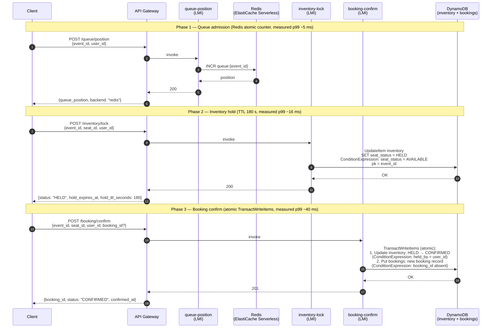

# Booking flow — request sequence

Three-phase booking flow across the ticketing app. Each successful booking
calls all three endpoints in order: queue → lock → confirm. Values match
the shipped defaults in `ticketing-app/template.yaml`.

## Notes on the flow

- **Sharded partition key.** The `inventory` table uses
  `pk = event_id#(crc32(seat_id) mod 500)` to spread writes across 500
  logical partitions. At 40 K TPS this keeps each shard around 80 WCU/s,
  well below DynamoDB's per-partition ceiling.
- **Idempotency.** The client may supply its own `booking_id` on
  `POST /booking/confirm` to make retries safe. A duplicate `booking_id`
  short-circuits to a `200 { idempotent: true }` instead of re-writing.
- **Optimistic locking.** Phase 2 conditions on `seat_status = AVAILABLE`,
  so at most one caller wins each seat. Losers get `409 seat_unavailable`.
- **TransactWriteItems atomicity.** Both writes in Phase 3 succeed or fail
  together. If the inventory condition fails (hold expired, or held by a
  different user), the bookings row is not written either.
- **Not shown here (happy path only).** The queue-position handler has a
  DynamoDB fallback if Redis is unavailable; both handlers return `409` on
  conflicts (already held, hold expired) and `503` on DDB errors.

## Handler-to-endpoint map

| Endpoint | Handler | Data plane |
|---|---|---|
| `POST /queue/position` | `queue_position/handler.py` | Redis (primary), DynamoDB (fallback) |
| `POST /inventory/lock` | `inventory_lock/handler.py` | DynamoDB `inventory` |
| `POST /booking/confirm` | `booking_confirm/handler.py` | DynamoDB `inventory` + `bookings` (atomic) |
